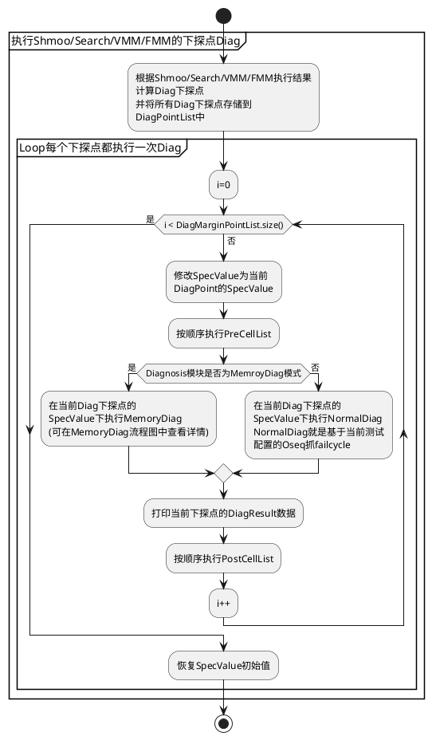
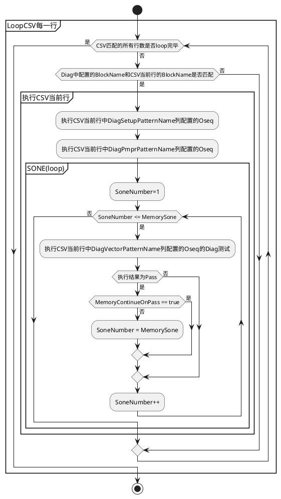
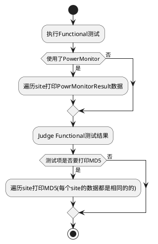
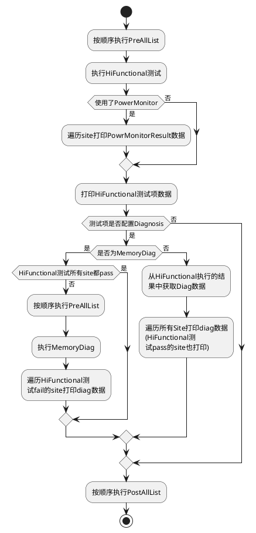

## 全局通用配置介绍

### 全局通用配置说明

为了便于用户调试，HiDigitalLink支持用户单独配置全局PrePostExecute、ExeSequenceList、LogFileType，此外当Diagnosis模块需要提升测试效率时，可以配置参数UseDiagFastResultMode
* 使用全局PrePostExecute只需要将PrePostExecute的spec和oseq配置一次，所有的测试项就可以直接调用
* 使用全局的ExeSequenceList在一个suite有多个模块的情况下，可以实现控制执行顺序或控制模块是否执行
* 使用全局LogFileType可以指定log文是否分site创建
* 将UseDiagFastResultMode设置为true可以提升Diagnosis模块的运行速率

### 用法示例

用户使用全局通用配置时需要在TestFlow的setup部分建一个测试项并调用HiDigitalLinkV2.HiDigitalLinkConfig作为TestMethod，如下所示：


```java
suite HDL_Config calls HiDigitalLinkV2.HiDigitalLinkConfig {
    GlobalExeSequenceList = #["SHM", "PM", "Vmm"];
}
```
测试项参数GlobalExeSequenceList用于配置全局的ExeSequenceList
测试项参数GlobalPrePostParameters用于配置全局的PrePostExecute

<font color =blue>使用全局通用配置suite需要注意：
1.该suite只需在TestFlow的setup部分定义既可，无需在execute部分调用execute方法
2.该suite一般只建一个如果建多个suite则只生效最后一个suite中的配置，其余均无效
3.debug模式下修改此suite参数不会立即生效，退出debug模式后下次运行生效
4.该suite只负责将全局配置传给底层数据，删除该suite时其配置底层数据依然生效，需要用户Load and Restore或者clean才能清除底层数据
</font>

### GlobalExeSequenceList说明

HiDigitalLinkV2的测试项可以将Vmm、Shmoo、PinMargin等模块放到同一个suite中，然而当用户有多个这样的suite时，如果想只跑Vmm模块就要将所有suite的其他模块注释掉，这样工作量会大幅度增加，然而使用GlobalExeSequenceList作为整体的配置，只需单独修改GlobalExeSequenceList中的内容，就可以指定需要执行的模块和执行顺序

**GlobalExeSequenceList作用**
1.可以控制所有suite的执行顺序
2.可以控制执行或不执行哪些模块(相当于全局控制所有HDLV2的suite哪些模块执行或不执行的flag)

**使用了HiDigitalLinkV2.BasicMethod的suite执行相关说明如下**
**<font color =coral>suite只配置一个主模块:</font>**
GlobalExeSequenceList和ExeSequenceList都无效，测试项必定执行配置的主模块

**<font color =coral>suite配置多个主模块且程序中配置了GlobalExeSequenceList:</font>**
1.suite如果使用了ExeSequenceList则GlobalExeSequenceList无效，并且ExeSequenceList中的元素必须是当前suite的parameterGroup的key，否则会报错
2.suite没有使用ExeSequenceList时，以GlobalExeSequenceList为主，GlobalExeSequenceList中的元素会去和每个测试项中HDL主模块的parameterGroup的key依次匹配，如果至少有一个能匹配到则运行匹配到的模块，如果全都没有匹配到，则按默认顺序执行
3.某些特殊的suite不想受到GlobalExeSequenceList的控制，但是其ParameterGroup的key却能与之匹配，此时可以修改ParameterGroup的key或者将suite参数UsingGlobalExeSequenceList设置为false

**<font color =coral>suite配置多个主模块但程序中没有配置GlobalExeSequenceList:</font>**
1.suite如果使用ExeSequenceList则ExeSequenceList中的元素必须是当前suite的parameterGroup的key，否则会报错
2.suite没有使用ExeSequenceList时按默认顺序执行

<font color =blueviolet>*提示：*
*1.程序中配置了GlobalExeSequenceList是指使用了HiDigitalLinkV2.HiDigitalLinkConfig作为TestMethod的测试项，并指定了GlobalExeSequenceList的值，未使用测试项或未指定值都视为没有配置*
*2.主模块是指Funtional、HiFunctional、Shmoo、SpecSearch、VminVmax、FminFmax、PinMargin，配置了对应的parameterGroup视为配置了该模块*
*3.默认顺序为：Func -> HiFunc -> SpecSearch -> Vmm -> Fmm -> PinMargin -> Shmoo，没有配置的模块跳过执行*</font>

### GlobalPrePostParameters说明

如果HiDigitalLinkV2.HiDigitalLinkConfig作为TestMethod的suite中配置了参数GlobalPrePostParameters那么其作用和在单个suite中配置了参数PrePostParameters一样，系统会根据preAllList、postAllList、preCellList、postCellList这四个List中的元素去匹配对应的key，从而执行PrePost功能。当然，<font color =red>如果suite中配置的PrePostParameters的key和GlobalPrePostParameters的key是相同的，则以suite的PrePostParameters配置为主</font>

<span id = "jump_GlobalLogFileType">

### GlobalLogFileType说明

用户可以在HiDigitalLinkV2.HiDigitalLinkConfig作为TestMethod的suite中配置参数GlobalLogFileType

HiDigitalLink可以根据用户配置将测试数据输出到文件中
<font color =blueviolet>GlobalLogFileType = Integrate时，所有site的数据会输出到同一个文件中
GlobalLogFileType = Decollate时，不同site的数据会输出到不同的文件中</font>
GlobalLogFileType参数默认值为Integrate，用户不定义时用默认值
</span>

### UseDiagFastResultMode说明

HDL的Diagnosis模块的测试log包含了每个pin的FailcycleNumber以及向量中的期望值等信息，当Smartest获取某个pin某行向量的期望值时需要遍历向量进行获取，这样是比较费时间的，因此ADV重新开发了一种查找方式从而避免遍历向量

HDL融合了新的查找方式，并且保留了原始的查找方式，用户可以通过将HiDigitalLinkV2.HiDigitalLinkConfig的测试项参数UseDiagFastResultMode设置为ture(默认为false)来使用新的查找方式

<font color =red>新的查找方式不通过遍历向量来获取期望值，因而获取的信息是有限的，所以UseDiagFastResultMode设置为ture时需要满足下列条件，否则收的数据可能有bug：</font>

    1.向量中只比较H或L，如果有M等比较，则无法使用新API，X不影响
    2.wavetable中的H只能对应采样动作H，L只能对应采样动作L
    3.Xmode小于4
    4.VOH=VOL且芯片输出电压也等于VOH和VOL时不能使用新API，当芯片无输出时，VT=VOH=VOL时也不能使用新API
    5.PSMLS(PSML)版本，不能使用新API

<font color =blue>UseDiagFastResultMode使用建议：
1.对测试时间无要求或Diagnosis测试本身花费时间较少时，UseDiagFastResultMode设置为false
2.向量是千万行级别的或者大向量运行VMMDiag、ShmooDiag时，满足UseDiagFastResultMode设置为ture的条件则可以将其设置为true</font>

------------

## 测试项数据配置介绍

### 概要说明 ##

* HiDigitalLink会生成STDF数据和打印的log数据，本节介绍如何配置这些数据的文件名称和路径，以便区分和收集数据

### STDF数据配置

HiDigitalLink会将测试数据存储到STDF中，可以右击TestProgram在Run as → Run Configureation 来配置需要的数据格式和路径

下图是配置STDF文件路径和名称的示例，其中${ENV.TIMESTAMP}为时间戳，增加时间戳以区分相同名称不同时间的数据

除了STDF格式的数据，其他格式的数据也支持用这种方法增加时间戳，详情请参考Smartest <font color =blue>**TDC**: 349273 </font>了解Smartest - <font color =blue> Automatically naming data log files </font>相关内容

### 测试项数据配置

<span id = "jump_logOutput">

除STDF外，我们通过SmartestAPI将一些数据提取出来作为测试项log数据直观的展示给用户，这些数据可以打印到UI(console)界面，也可以保存成txt文件

测试项(TestSuite)使用HiDigitalLinkV2里面的TestMethod时，每个模块都可以通过参数<font color =blue> output </font>来配置当前模块的log输出的位置，每个测试项都可以通过参数<font color =blue> logFileName </font>来配置log数据文件路径

**参数解释**

**<font color =blue>output</font>** :枚举类型，有4种选择FILE，REPORTUI，FILE_REPORTUI和NONE，用户控制log数据的输出位置
-- NONE ：代表不输出
-- REPORTUI ：代表输出到UI(console)
-- FILE ：代表输出到file，file名称和路径由参数<font color =blue> logFileName </font>来配置
-- FILE_REPORTUI ：代表即输出到file，又输出到UI(console)

</span>

在HiDigitalLink的Functional、HiFunctional、SpecSearch、VminVmax、FminFmax、Shmoo、PinMargin、Diagnosis、PowerMonitor这些模块对应的ParameterGroup中里都有这个参数，DiagnoisParameters中默认值为FILE，其他ParameterGroup中默认值为FILE_REPORTUI

<font color =FireBrick>output控制的只是当前模块log数据的输出，各模块互相独立，并且和STDF数据也无关。STDF只要配置则必定输出，因此只收集STDF数据而不关注log数据时，可以将output设置为NONE</font>

**<font color =blue>logFileName</font>** ：String类型，默认值为: \<device目录>/report/HiDigitalLink

<font color =red>logFileName 可作为TestSuite参数或部分模块ParameterGroup的参数进行配置，如果suiteParameterGroup都有配置logFileName，则模块输出log时以ParameterGroup中的logFileName为主</font>

<font color =blueviolet>Diagnosis和PowerMonitor运行在其他模块中，这两个模块log输出到文件时，会输出到当前运行模块的log文件中，例如：
一个suite包含了 VMM、Shmoo、Diag，此时，运行suite时，VMM和Shmoo模块都会执行Diag，如果VMM和Shmoo模块设置了不同参数logFileName，则VMM的下探点的Diag数据会打印到VMM设置的log文件中，Shmoo的Diag数据会打印到Shmoo设置的log文件中</font>

当测试项的log数据需要输出到文件时用此参数指定文件路径和名称，实际生成的文件会在文件名称末尾加上时间戳信息和.txt后缀。如果用户配置的文件名有后缀(例如：.edf)，系统会将其改为.txt后缀

参数配置示例：

- HiFunctional模块output配置为NONE，不会打印log数据，因此参数logFileName对HiFunctional模式来说是无效的
- VminVmax模块output配置为FILE，log数据会被输出到\<device目录>/report/hdlv2Outputest<时间戳>.txt文件中
-  Shmoo模块output配置为FILE_REPORTUI，Shmoo的log数据会被输出到UI(console)和上面VimVmax同一个文件中
- PinMargin的log数据只输出到UI(console)

### 实际生成的log文件名称说明

**文件名称前缀说明**

-- 如果各个模块和Testsuite都未配置logFileName，则文件前缀使用 \<device目录>/report/HiDigitalLink
-- 当配置的路径以 '/' 开头时，为绝对路径，路径不存在会报错停止
-- 当配置的路径不是以 '/' 开头时，为相对路径，默认从当前Device路径开始查找，路径不存在会报错停止。只配置文件名称不指定路径时文件前缀名device路径(即log默认生成到当前Device目录下)

**文件名称后缀说明**
GlobalLogFileType = Integrate时，文件名称后缀为<时间戳>+.txt
GlobalLogFileType = Decollate(默认值)时，文件名称后缀为\<siteNumber>+<die坐标信息(获取不到时没有)>+<时间戳>+.txt


**实际生成文件名称**
实际生成文件名称为前缀+后缀

**时间戳刷新说明**
GlobalLogFileType = Integrate时，在TestMethod的setup第一次运行时刷新时间戳，当运行了execute时刷新时间戳的flag重新开启，下次运行setup时时间戳会再次刷新，未运行execute而多次运行setup时时间戳不会刷新

GlobalLogFileType = Decollate(默认值)时，系统记录第一个运行execute的测试项名称并在此测试项刷新时间戳，之后每次运行这个测试项的execute时时间戳会再次刷新

<font color =red>注：在debug时，第一个运行的suite不一定是整个flow的第一个执行的suite，所以debug完成后需要LoadAndRestor(清除系统记录的第一个运行的TestSuite名字)后再收测试数据(否则在GlobalLogFileType = Decollate可能会产生两个时间戳，进而生成两个文件)</font>
loadAndRestor操作：右击TestProgram -> 选择点击 Load and Restore

------------


### HDL测试项TestDescriptor配置

* HDLV2中测试项的limit、bin等信息都是TestDescriptor对象的属性，可以在TestTable中配置，也可以在TestSuite的ParametreGroup中配置
* 当前HDLV2中只有Functional、HiFunctional、PowerMonitor模块支持用户自己配置TestDescriptor属性，这三个模块的TestDescriptor对象都定义在了其模块对应的ParameterGroup中，因而ParameterGroup中可以设置TestDescriptor对象的属性，而大多数情况下则是在TestTable中设置

HDLV2中的TestDescriptor对象如下表，每个Descritpor对象都可以配置limit和bin等属性
|所属模块|所属ParameterGroup名称|类型|Descriptor对象名称|
|----|----|----|----|
|Functional|FuncParameters|IFunctionalTestDescriptor|<font color =blue>FcTestDescriptor</font>|
|HiFunctional|HiFuncParameters|IFunctionalTestDescriptor|<font color =blue>FcTestDescriptor</font>|
|PowerMonitor|PowerMonitorParameters|IParametricTestDescriptor|<font color =blue>DcProfilingDescriptorMAX</font>|
|PowerMonitor|PowerMonitorParameters|IParametricTestDescriptor|<font color =blue>DcProfilingDescriptorAVG</font>|


**TestDescritor的limit和bin等属性配置方式示例：**
1.在TestTable中配置：

<font color =FireBrick>如果在TestTale配置不生效，需要细检查Descriptor的Fully qualified name是否正确，并且需要确保在Main_Test sheet中</font>

2.在TestSuite中配置：
<font color =FireBrick>如果在TestTable中也进行了配置，TestTable的配置会覆盖测试项中ParameterGroup中的配置</font>

------------

## 同质die测试(CCT功能)用法介绍

### 模块简介

HiDigitalLink支持Shmoo和SpecSearch(VminVmax)获取同质die的测试结果，即：执行完测试后系统会根据配置的相关信息，检索出每个同质die的Shmoo图或SpecSearch图
Shmoo和SpecSearch的同质die测试都支持BySignal(Bypin)和ByCycle两种模式的测试

### 测试项示例


如上图所示，Shmoo和SpecSearch同质测试项需要指定参数Specification和OperatingSequence，并且SpecSearch和Shmoo也分别支持SpecSearchParameters和ShmooParameters这两个ParameterGroup用以指定相关参数的值，不配置时使用默认值

DieCycleParameters和DieSignalParameters分别是同质die测试ByCycle模式和BySignal模式要用的ParameterGroup，使用哪种模式就配置对应ParameterGroup，两种模式不能同时使用

### BySignal(Bypin)模式介绍

#### BySignal模式测试项配置示例
BySignal模式，即不同的Signal(Signal指pin)的PassFail代表不同die的测试结果，需要用到DieSignalParameters这个ParameterGoup指定die和Siagnal的对应关系

### ByCycle模式介绍

#### ByCycle模式测试项配置示例

ByCycle模式，是部分Signal(pin)的部分cycle的PassFail代表不同die的测试结果，向量、Signal、die信息、对应的cycle信息等都配置在CSV中

**ByCycle模式CSV说明**

<font color=blue>PatternName列</font>：程序会遍历PatternName列，看其是否在CCT测试项的OperatingSequence中被call了，如果被call，视为匹配到的pattern名称为此测试项的同质die测试所用的pattern，匹配不成功则直接报错
<font color=blue>Process列</font>：如果为based_on_cycle则认为CSV此行有效，之后会提取此行的信息，如果为remain_reslut系统会将处理remain_result结果的flag打开
<font color=blue>DieNumber列</font>：DieNumber相同时，记为一个同质die
<font color=blue>DieAliasName列</font>：Die的别名打印log时用到，dieNumber相同而DieAlasName不同时则以第一个DieAliasName为主，一搬dieNamber和DieAliasName是一一对应的
<font color=blue>PinList列和cycleList列</font>：这两列分别填写同质die的pin(signal)对应的cycle，允许一个die具有多个pin和cycle的对应信息，测试时die对应的任意一个pin的任意一个Cyclelist的cycle有fail，则认为此diefail

<font color=readFile >remain_result说明</font>：同一个PatternName下如果此pattern的failcycle并不是有效的Cyclelist列中的cycle则remain_resultfail

**编辑时CSV注意事项**
注意CSV本身是文本文件，每个单元格用逗号分隔，而部分编辑器编辑CSV后，会给每个单元格加上双引号，而导致向量匹配失败，因此需要注意csv的底层格式，如果每个单元格被加了双引号删除双引号即可

**ByCycle模式ParameterGroup参数解释**
测试项需要用到DieCycleParameters这个ParameterGroup指定CSV的路径等参数，不指定的参数时使用默认值
|参数名称|参数类型|参数默认值|参数介绍|
|----|----|----|----|
|inputCSV|String|resource/CCT_block.csv|ByCycle模式的部分配置在CSV里面，此参数用于指定CSV的路径和名称，'/'开个头为绝对路径，非'/'开头为当前DeviceProject目录下的相对路径
|maxFialPerSignal|int|10000000|Smt8获取failcycle时，要指定每根pin上获取的failcycle的数量，此参数默认为10000000，当一根pin上一千万个failcycle不能满足测试需求使，用户可将此参数修改更大|

### 测试结果说明

<font color = red>Summary结果表示所有die fail的结果取交集(注意: 并不是整个OperatingSequence的测试结果)</font>
SpecSearch是否细扫由SummaryResult的粗扫结果是否有margin决定
ByCycle模式中如果使用了remain_result，Summary取交集时也包含remain_result的结果

------------

## Diagnosis模块用法介绍

### Diagnosis模块简介

* NormalDiag模式用于抓Failcycle、MemoryDiag模式用于执行MemoryDiag
* HiDigitalLinkV2支持Diagnosis的模块为HiFunctional、Shmoo、SpecSearch/VminVmax/FminFmax
* Functional模式和PinMargin模式不支持Diagnosis

### Diagnosis配置介绍

<font color =FireBrick>DiagnosisParameters类型为ParameterGroup，当测试项配置了DiagnosisParameters时，此测试项会检索其配置的其他模块，并在支持Diagnosis的模块中执行对应的Diag测试。</font>

NormalDiag用于抓取当前测试项配置的OperatingSequence中向量的failcycle
MemoryDiag用于执行MemoryDiag向量，并抓取failcycle

<font color =FireBrick>当DiagnosisParameters中配置了MemoryBlockName的值并且其不为空时，Diag为MemroyDiag模式否则为NormalDiag模式</font>

### 参数介绍

<span id = "jump_diagParameters">

#### DiagnosisParameters
Diag模块相关的参数在DiagnosisParameters中配置，<font color =FireBrick>每个测试项只能配置一个DiagnosisParameters</font>

**NormalDiag相关参数**
|参数名称|参数类型|参数默认值|参数介绍|
|----|----|----|----|
|diagType|enum|DETAIL|用于控制Search/VMM/FMM、Shmoo出现HardFail时，Margin点的计算数量，可选DETAIL、STANDARD、SIMPLE，选STANDARD时，HardFail时执行一个中心点的Diag、非STANDARD时会以中心点向外扩散多扫一些点的Diag|
|dpsVoutToLogValue|List|<无默认值>|填入需要输出Value的DPS_Signal(DPS_Pin)名称，DPS_Signal必须是dcVI_Instrument类型|
|specToLogValue|List|<无默认值>|填入需要输出Value的Spec|
|resultLogPin|String|"@"|填入Result输出的Pin，填入"@"时默认打印Oseq的向量中的所有pin的Result，多个Signal(Pin)名称或SignalGroup用"+"连接|
|maxFailsPerpin|int|7000|用于指定在每根pin上检索fail信息的最大数量，<font color =FireBrick>该值的大小会影响执行效率，如果该值指定的很大并且当前测试项fail的数量也较多，测试项的执行时间会相对增加，因此建议该值不要超过7000</font>|
|isCycleNumberPerLabel|boolean|false|指定是否单独打印每条向量的failcycle，为True时会分别打印Oseq中的每条向量的failcycle数据，failcyclenumber从每条向量开始计算，为false时failcycle会从Oseq中第一个向量开始算，并且fail的数据不会分向量打印|

</span>

**MemoryDiag特有参数**
如果测试要执行MemoryDiag则除了要指定上面NormalDiag相关参数外还需要指定下列MemoryDiag相关参数，所有MemoryDiag特有参数都是以Memory开头以便区分前面参数
|参数名称|参数类型|参数默认值|参数介绍|
|----|----|----|----|
|MemoryCSVPathAndNeme|String|"resource/diag_memory.csv"|用于指定MemooryDiag功能要用的csv路径，'/'开个头为绝对路径，非'/'开头为当前DeviceProject目录下的相对路径
|MemoryBlockName|String|<无默认值，即：Diag功能默认为NormalDiag>|用于控制Diagnosis是否为MemoryDiag，即指定此参数时为MemoryDiag，并且此参数会去匹配csv文件中的MemoryBlockName|
|MemoryContinueOnPass|boolean|false|用于指定MemoryDiag在SONE(loop)执行时，遇到Pass是否要退出Loop
|MemorySone|int|50|用于指定SONE(loop)次数|

**log相关参数**
|参数名称|参数类型|参数默认值|参数介绍|
|----|----|----|----|
|[output]|enum|FILE_REPORTUI|用于控制log输出，可选FILE、REPORTUI、FILE_REPORTUI、NONE|
|[logFileName]|String|report/HiDigitalLink|log数据输出文件时，指定文件路径和名称|

### 下探点Diag说明

除HiFunctional模式外，HiDigitalLink其他支持Diag的模式如果配置了Diag则会执行下探点Diag，与HiFunctionalDiag不同的是Margin点Diag可能是在SpecValue被修改了的情况下执行的，<font color =FireBrick>在HiDigitalLink中，Diagnosis使用的spec和当前测试配置的Specification是同一个</font>，因此当Margin点修改了specValue，那么被修改的SpecValue也会映射到Diagnosis

当FminFmax(Search频率)配合Diag执行时，如果出现不同Site跑不同频率的情形导致Smartest报错，则可以在Diag或MemoryDiag的OperatingSequence中设置sync=none
**下探点Diag执行流程**
<span id = "jump_DiagMarginPoint">



</span>

### MemoryDiag功能说明

- MemoryDiag一般执行RAM诊断程序测试，一般会跑多个向量，并loop诊断向量
- MemoryDiag的每个OperatingSequence都会绑定一个Measurement，Measurement绑定的spec是当前测试项的Specification
- MemoryDiag相关的OperatingSequence(向量)会被配置到csv文件中(csv文件名称一般为diag_memory.csv)

<font color =FireBrick>由于HiDigitalLinkV2要求所有向量都要放到Oseq中，所以，如果只有向量文件没有对应的OperatingSequence，则需要新建一个OperatingSequence，并call对应向量</font>

在CSV每一行的执行DiagVectorPatternName列向量时，SONE(loop)过程中，实际SONE(loop)次数由MemoryDiag参数MemorySone和MemoryContinueOnPass共同决定，<font color =red>MemoryContinueOnPass为false时，SONE(loop)时遇到pass就会终止loop，MemoryContinueOnPass为true时SONE(loop)遇到pass不会终止loop</font>

<span id = "jump_MemoryDiag">

**MemoryDiag执行逻辑及流程图**
<font color =FireBrick>无论是HiFunctional模式的正常MemoryDiag还是Shmoo、Search/VMM/FMM中的下探点的MemoryDiag，MemoryDiag的执行流程都一样的</font>
- CSV中匹配到的每行信息按顺序整理起来，每行最为一个MemroyDiag执行模块，遍历完所有匹配到的CSV行数后执行完毕
- 每行的执行流程: 先将CSV中的第二和第三列的OperatingSequence跑一遍(如果有指定)，然后开始loop执行第四列中的Oseq

下图为meomoryDiag执行流程图，图中MemorySone和MemoryContinueOnPass为Diag模块用户配置的参数



</span>

### Diag测试测试结果

<font color =FireBrick>当isCycleNumberPerLabel为false时，TOTF_CNT、TOTL_CNT、TOTP_CNT这些数据是基于整个Oseq的</font>
TOTF_CNT、TOTL_CNT、TOTP_CNT分别代表当前Oseq中总的failcycle数量、总的logfailcycle数量、总的failpin数量。
每根pin的TOTF_CNT、TOTL_CNT分别代表当前pin在整个Oseq中总的failcycle数量、总的logfailcycle数量

<font color =FireBrick>当isCycleNumberPerLabel为True时，TOTF_CNT是基于整个Oseq的，TOTL_CNT、TOTP_CNT是基于当前Label的</font>
TOTF_CNT代表当前Oseq中总的failcycle数量
TOTL_CNT、TOTP_CNT分别代表当前Label的failcycle数量和logcycle数量。
每根pin的TOTF_CNT代表当前pin在整个Oseq中总的failcycle数量
每根pin的TOTL_CNT代表当前pin在当前label中的的logfailcycle数量

------------

## Functional模块用法介绍

### Functional模块简介

Functional模块一般用于量产跑FunctionalTest，此模块只保存整体的PassFail结果到STDF中，若不打印MD5，Functional模块将无log数据输出，<font color =FireBrick>Functional模式不支持PrePostExecute和Diagnosis，如果配置了Diagnosis对于Functional模式也是无效的</font>

### 参数介绍

点击蓝色字体参数名称可查看详细介绍

<span id = "jump_FCparameters">

#### FuncParameters参数

|参数名称|参数类型|参数默认值|参数介绍|
|----|----|----|----|
|printMD5|boolean|false|用于控制是否要打印当前测试项OperatingSequence中call的pattern的MD5码
|MD5patternBaseFolders|List|#["src"]|指定当前测试项OperatingSequence中所call pattern的路径，当测试项需要打印MD5码时使用，List的每个元素代表一个路径，可以指定多个路径|
|[output](./测试数据配置介绍.md#jump_logOutput)|enum|FILE_REPORTUI|用于控制log输出，可选FILE、REPORTUI、FILE_REPORTUI、NONE|
|[logFileName](./测试数据配置介绍.md#jump_logOutput)|String|report/HiDigitalLink|log数据输出文件时，指定文件路径和名称|
</span>

#### 测试项公共参数

|参数名称|参数类型|参数默认值|参数介绍|
|----|----|----|----|
|Specification|String|<无默认值>|指定测试项调用的Specification|
|OperatingSequence|String|<无默认值>|指定测试项调用的OperatingSequence|
|[logFileName]|String|report/HiDigitalLink|log数据输出文件时，指定文件路径和名称|
|[ExeSequenceList]|List|<无默认值>|测试项使用多个模块时，控制各模块执行顺序|

### 测试项Limit和bin信息配置

HDLV2的Functional模块支持用户配置Limit和bin等信息

### Functional模式执行流程图

### Functional模式测试结果

#### FunctionalTest结果
Functional模式的FunctionTest结果会保存到STDF中，对用户来说没有额外数据
#### MD5打印结果
当参数printMD5为true时系统会获取MD5码并根据用户配置的参数output做相关打印，使用MD5时需要确保TestProgram命名规范，否则解析出的信息将有误

此外我们的MD5结果还会打印到<device目录>/report/PatternMD5.csv中

当OutPut为NONE时，只能从此文件中查看打印的MD5，其他地方不会有MD5相关数据

------------

## HDLV2用法介绍

### 资源获取与配置
HiDigitalLinkV2我们以jar包的形式提供给用户，jar包适用于Smartest8.4.4以上的所有Smartest版本
点击下表中的蓝色字体获取对应版本的jar包(当前1.0Beta3版本兼容前两个版本)
|HDL版本号|jar包名称|简介|
|----|----|----|
|1.0Beta||初版代码，供用户使用和反馈意见|
|1.0Beta2||根据用户反馈，给每个有log输出的模块都增加了logFileName配置，同时保留了整个测试项的logFileName配置。修复了多个模块共同使用PrePost功能时创建Measurement名称重复导致报错的bug|
|1.0Beta3||根据用户需求，增加了PowerMonitor功能，增加了用户可以配置Functional、HiFunctional、PowerMonitor模块的limit和bin信息的功能|
|1.0Beta4||增加全局配置功能，支持全局配置PrePostExecute和ExeSequenceList|
|1.0Beta5||PrePostExecute功能执行cell时是否修改spec，通过参数specVarChangeInCell配置(默认不修改)，取消原来和测试项spec一致就修改不一致就不修改的规则|
|1.0Beta6||修复Shmoo模块X轴和Y轴Point数量不一致时Shmoo结果异常的bug，增加参数enableSignals，用于解决psmls板卡不兼容的问题|
|1.0Beta7|[HiDigitalLinkV2.jar](../HDLV2_SMT8_jar/HiDigitalLinkV2.jar) [MyDigitalLinkV2.jar](../HDLV2_SMT8_jar/MyDigitalLinkV2.jar)|新增log输出到文件时，按照运行次数和siteNumber分文件的功能，文件名称增加siteID、dieID信息(dieID获取不到时没有)|
|1.0Beta11|[HiDigitalLinkV2.jar](../HDLV2_SMT8_jar/Beta11/HiDigitalLinkV2.jar)|新增CCT功能，新增importSpec功能|
|1.0Beta13|[HiDigitalLinkV2.jar](../HDLV2_SMT8_jar/Beta13/HiDigitalLinkV2.jar)|初步优化了CCT的log格式，并集成了DiagFastResult功能(用法参考全局通用配置)|

用户将jar包放到项目目录下或其子目录中后，右击选Build Path -> Add to Build Path即可配置完成


### 测试项用法说明

#### 测试项配置示例
第一步：使用HiDigitalLinkV2包里的BasicMethod类作为测试的TestMethod
第二步：配置OperatingSequence和Specification，填写对应的Fully qualified name（这一步相当于配置测试项的向量、Level和Timing，<font color =FireBrick>每个HiDigitalLinkV2测试项必须配置</font>）
第三步：通过ParameterGroup配置，选择对应功能(示例中ParameterGroup用到是Shmoo模块的ParameterGroup，因此当前测试项会执行Shmoo功能)

按照上面示例就配置了一个执行Shmoo的测试项，由于<font color =FireBrick>每个ParameterGroup里的所有参数都有默认值</font>，所以这样简单的配置就可以执行当前TestSuite。
<font color =FireBrick>HiDigialLinkV2只能配置OperatingSequence不能配置单条向量，因此如果只有向量没有OperatingSequence则需要新建OperatingSequence并call对应的向量</font>

**importSpec**：如果你的测试项有多个Spec文件，可以手动建一个mainSpec将其他文件import进去，如果不想手动import，HiDigitalLin支持使用DSA将用户配置的需要import的spec整合成一个MainSpec

### 测试项参数说明

#### 测试项整体参数表

下表展示了HiDigitalLinkV2的测试项参数，上面测试配置示例中已经展示Specification和OperatingSequence的配置方法。

|参数所属模块|参数类型|参数名称|参数说明|
|----|----|----|----|
|整个测试项|String|Specification|指定测试项调用的Specification|
|整个测试项|String|OperatingSequence|指定测试项调用的OperatingSequence|
|整个测试项|String|[logFileName](./测试数据配置介绍.md#jump_logOutput)|测试项log数据输出文件路径和名称|
|Functional|ParameterGroup|[FuncParameters](./Functional模块用法.md#jump_FCparameters)|Functional模块所有参数配置|
|HiFunctional|ParameterGroup|[HiFuncParameters](./HiFunctional模块用法.md#jump_HiFCparameters)|HiFunctional模块所有参数配置|
|Shmoo|ParameterGroup|[ShmooParameters](./Shmoo模块用法.md#jump_ShmooParameters)|Shmoo模块所有参数配置|
|SpecSearch|ParameterGroup|[SpecSearchParameters](./Search模块用法.md#jump_SearchParameters)|SpecSearch模块所有参数配置|
|VminVmax|ParameterGroup|[VminVmaxParameters](./Search模块用法.md#jump_SearchParameters)|VminVax模块所有参数配置|
|FminFmax|ParameterGroup|[FminFmaxParameters](./Search模块用法.md#jump_SearchParameters)|FminFmax模块所有参数配置|
|PinMargin|ParameterGroup|[PinMarginParameters](./PinMargin模块用法.md#jump_PinMarginParameters)|PinMargin模块所有参数配置|
|PrePostExecute|ParameterGroup|[PrePostParameters](./PrePostExecute模块用法.md#jump_PrePostParameters)|PrePostExecute功能参数配置|
|Diagnosis|ParameterGroup|[DiagnosisParameters](./Diagnosis模块用法.md#jump_diagParameters)|Diagnosis功能参数配置|
|整个测试项|List|[ExeSequenceList](#jump_usingMultiModule)|	测试项使用多个模块时，控制各模块执行顺序|
|整个测试项|Boolean|UsingGlobalExeSequenceList|控制测试项是否受GlobalExeSequenceList的控制|

除了上面参数之外，HiDigitalLinkV2还支持全局配置PrePostExecute、全局控制各模块执行的功能(上表中最后一个参数UsingGlobalExeSequenceList与之相关)

Smartest8支持用户使用表格的方式快速编辑测试项参数

#### 参数解释

**所有ParameterGroup**
HiDigitalLinkV2每个模块都有对应的ParameterGroup，<font color =FireBrick>对于Functional、HiFunctional、Shmoo、SpecSearch、VminVmax、FminFmax、PinMargin而言，配置了对应的ParameterGroup就相当于配置了对应模块，Smartest就会执行对应功能</font>。此外PrePostExecute和Diagnosis也有对应的ParameterGroup来配置，<font color =red>PrePostExecute功能对应的ParameterGroup可以配置多次，其他的ParameterGroup只能配置一次</font>

<font color =FireBrick>所有ParameterGroup的key没有要求，可自由填写。如果一个测试项使用多个模块时，建议每个模块填写不同的key，否则只能生效一个优先级高的模块，优先级：Shmoo > pinMargin > FminFmax > VminVmax > SpecSearch > HiFunctional > Functional)</font>

**测试项直接配置的参数**
除ParameterGroup类的外，参数<font color =blue>Specification、OperatingSequence和logFileName</font>为测试的特有参数，其中Specification和OperatingSequence是每个测试项必须配置的(上面测试项配置示例中已经说明)，<font color =blue>logFileName</font>是可选的，用于配置测试项log数据输出文件路径和名称

#### 参数快捷配置

**参数快捷配置方式**
<font color =FireBrick>用户编辑测试项参数时，按Ctrl+空格键，Smartest就会出现对应的参数和ParamterGroup名称</font>，用户可以快速配置


#### 测试项使用多个模块参数配置

**多个模块共同使用需要配置ExeSequenceList** 
HiDigitalLink的主模块包括Funtional、HiFunctional、Shmoo、SpecSearch、VminVmax、FminFmax、PinMargin这七个模块，如果一个测试项配置了上面七个模块的任意两个或两个以上的模块，那么系统会判断当前测试使用了多个模块，此时<font color =FireBrick>如果不配置参数<font color =blue>ExeSequenceList</font>，系统会按照Func -> HiFunc -> SpecSearch -> Vmm -> Fmm -> PinMargin -> Shmoo这样的优先级进行执行，并不能按照用户配置的ParameterGroup顺序执行</font>(这是由Smartest机制决定，DFT小组无法优化)
<font color =FireBrick>如果用户要控制执行顺序就需要配置参数</font><font color =blue>ExeSequenceList</font>，将各模块的ParameterGoup对应的key按照想要执行的顺序，配置到ExeSequenceList的元素中即可

图中的测试项配置了HiFunctional、VminVmax、Shmoo、PinMargin这个四个模块，并将各个模块关键字配置到了ExeSequenceList中，因此当前测试项执行时会按照Shmoo->PinMargin->VminVmax->HiFunctional->HiFunctional这样的顺序执行。如上图所示HiFunctional的关键字'hi'在ExeSequenceList中出现两次，HiFunctional在当前测试项中也会执行两次

注：由于ExeSequenceList这个参数仅在多个主模块共同配置时生效，所以当用户只配置了一个主模块时，ExeSequenceList中即使配置多次这个模块的key，测试项也只能执行一次这个模块
<span id = "jump_usingMultiModule"></span>

------------

## HiFunctional模块用法介绍

### HiFunctional模块简介

HiFunctional模块一般用于调试，此模块可以根据用于配置的参数选择是否打印PerPin、PerLabel的数据，支持和PrePostExecute功能以及Diagnosis功能共同使用


### 参数介绍

<span id = "jump_HiFCparameters">

#### HiFuncParameters参数
|参数名称|参数类型|参数默认值|参数介绍|
|----|----|----|----|
|[log_per_pin](#jump_hifuncResultType)|boolean|false|用于控制是否要打印PerPin的PassFail结果到STDF和log数据|
|[resultType](#jump_hifuncResultType)|enum|ALL|用于控制HiFunctionalResult的输出详细程度，可选ALL和PER_LABEL，选ALL时只打印整体Result，选PER_LABEL时在打印整体Result的同时，会单独打印每条向量的结果到STDF和log数据|
|[output](./测试数据配置介绍.md#jump_logOutput)|enum|FILE_REPORTUI|用于控制log输出，可选FILE、REPORTUI、FILE_REPORTUI、NONE|
|[logFileName](./测试数据配置介绍.md#jump_logOutput)|String|report/HiDigitalLink|log数据输出文件时，指定文件路径和名称|
|[preAllList](./PrePostExecute模块用法.md)|List|<无默认值>|用于控制PreExecute中All的执行顺序|
|[postAllList](./PrePostExecute模块用法.md)|List|<无默认值>|用于控制PostExecute中All的执行顺序|

</span>

#### 测试项公共参数

|参数名称|参数类型|参数默认值|参数介绍|
|----|----|----|----|
|Specification|String|<无默认值>|指定测试项调用的Specification|
|OperatingSequence|String|<无默认值>|指定测试项调用的OperatingSequence|
|[logFileName](./测试数据配置介绍.md#jump_logOutput)|String|report/HiDigitalLink|log数据输出文件时，指定文件路径和名称|
|[ExeSequenceList](./HDLV2用法介绍.md#jump_usingMultiModule)|List|<无默认值>|测试项使用多个模块时，控制各模块执行顺序|

### 测试项Limit和bin信息配置

HDLV2的HiFunctional模块支持用户配置Limit和bin等信息
### HiFunctional模式执行流程图

<span id = "jump_HiFC_Flow">




</span>

#### HiFunctional模式测试结果

参数<font color =blue>log_per_pin为true</font>时会打印perPinResult，参数<font color =blue>resultType为PER_LABEL</font>时会打印每条向量的Result，log数据输出由参数output控制

<span id = "jump_hifuncResultType"></span>
