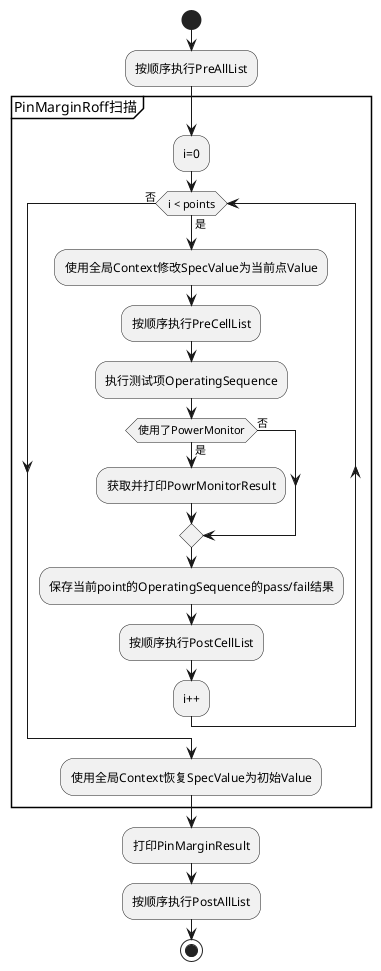
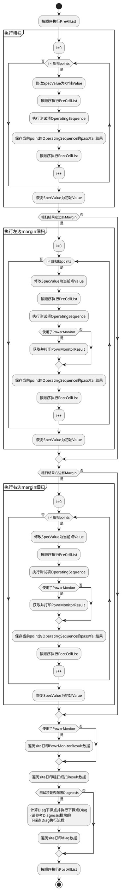
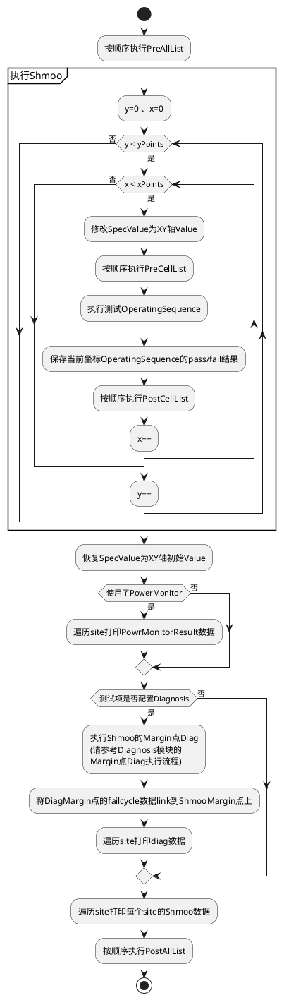

## ImportSpec功能介绍

当用户有多个Spec时可以使用ImportSpec功能进行参数设置

### 测试项配置

配置SpecsImport这个ParameterGroup的参数spec，即指定了当前测试项需要import的Spec(可以指定多组)，HiDigitalLink会使用DeviceSetupAPI将这些spec组和成一个mainSpec，此mainSpec的名称会作为测试项参数Specification的值

### PrePost使用ImportSpec

一个测试项无论配置了多少个PrePostParameters，所有PrePost配置需要用到的ImporSpec都使用PrePostSpecsImport这个ParameterGroup来配置
由于PrePostParameters可能会指定多组，如果使用ImportSpec功能需要使用参数useSpecsImportList来指定当前配置需要用import哪些Spec，useSpecsImportList的每个元素为PrePostSpecsImport的key
PrePostParameters配置了useSpecsImportList时不用配置参数spec

------------

## PinMargin模块用法介绍

### PinMargin模块简介

* PinMargin底层原理也是Search，但是其没有细扫。在HDLV2中，PinMargin也支持PrePostExecute功能

### 参数介绍

**PinMarginParameters参数**

|参数名称|参数类型|默认值|参数介绍|
|----|----|----|----|
|specVariable|String|"Roff"|填写扫描的Spec变量名称|
|start|double|-0.5|填写扫描下限，在log中展示值Roff_LL_ADJ|
|stop|double|0.5|填写扫描上限，在log中展示值为Roff_UL_ADJ|
|points|int|11|填写粗扫点数量|
|Tper|String|Tcoef|填写测试项Specification中定义周期的系数，一般为Tcoef|
|[output](./测试数据配置介绍.md#jump_logOutput)|enum|FILE_REPORTUI|用于控制log输出，可选FILE、REPORTUI、FILE_REPORTUI、NONE|
|[logFileName](./测试数据配置介绍.md#jump_logOutput)|String|report/HiDigitalLink|log数据输出文件时，指定文件路径和名称|
|[preAllList](./PrePostExecute模块用法.md)|List|<无默认值>|用于控制PreExecute中All的执行顺序|
|[postAllList](./PrePostExecute模块用法.md)|List|<无默认值>|用于控制PostExecute中All的执行顺序|
|[preCellList](./PrePostExecute模块用法.md)|List|<无默认值>|用于控制PreExecute中Cell的执行顺序|
|[postCellList](./PrePostExecute模块用法.md)|List|<无默认值>|用于控制PostExecute中Cell的执行顺序|

### 参数解释

**Tper**：此参数一般为测试项Specification文件里定义的Tcoef，在扫描PinMargin时该值一般为1，如果该值不为1，则会影响pinMargin计算的扫描点的值。PinMargin的每个扫描点的值由起始点到终止点通过均等分计算的值再乘Tper的值得出

**specVariable**：扫PinMargin时此参数一般为测试项Specification文件里定义的Roff，Roff通常为Double类型，PinMargin的每个扫描点的值代表Roff的实际值(每个点最多保留三位小数)，因此Spec文件中要求ReceiveEdge定义成类似" r1 =((0.34 * per_38 + Roff) * Tcoef) * 1 ns; "的格式(注意单位换算)

Tper配置为Tcoef并且其值为1，start为-0.5，stop为0.5，Point为11，

#### 测试项公共参数

|参数名称|参数类型|参数默认值|参数介绍|
|----|----|----|----|
|Specification|String|<无默认值>|指定测试项调用的Specification|
|OperatingSequence|String|<无默认值>|指定测试项调用的OperatingSequence|
|[logFileName](./测试数据配置介绍.md#jump_logOutput)|String|report/HiDigitalLink|log数据输出文件时，指定文件路径和名称|
|[ExeSequenceList](./HDLV2用法介绍.md#jump_usingMultiModule)|List|<无默认值>|测试项使用多个模块时，控制各模块执行顺序|

### PinMargin模式执行流程图

------------

## PowerMonitor模块用法介绍

### PowerMonitor模块简介

* HDLV2的PowerMonitor功能支持DC Profiling和constant current alarm检查
* 在Smartest8中，对于测试的执行是放到OperatingSequence中的，不能通过TestMethod代码直接操作硬件，因此CC Alarm和DcProfiling的应用方式和Smartest7是不同的，Smartest7中通代码可以enable和配置属性，而Smartest8是通过配置instrument属性实现的

### PowerMonitor功能使用简介

* 当instrument属性配置了CC Alarm检查和DcProfiling后，在HDLV2的suite中通过指定PowerMointor模块的参数就能获取相应的结果

### Instrument属性配置

Smartest8中配置为DcVI instrument的signal(pin)可以配置CC Alarm检查和DC Profiling。通常的DPS pin都会被配置DcVI Instrument

在DcVI Instrument中使用DcProfiling功能至少要配置profiling.profilingMode、profiling.sampleRate、level.iclamp这三个属性
在DcVI Instrument中使用constant current alarm check功能需要将alarm.currentClamp配置为enabled

DcVI的profiling和alarm属性可参考TDC了解详情：

|DcVI属性|TDC Topic|
|----|----|
|profiling|TDC:0190698550|
|alarm|TDC:0336655969|

**配置方法1：**
从specification文件或其import的文件中，找到要做CC检查和DcProfiling的所有signal(pin)的DcVI instrument属性配置的地方，加上alarm和profiling的相关配置即可，

如果定义instrument属性的文件被多个specification文件所import，而一些测试是不需要配置PowerMonitor功能相关属性的，所以需新建spec文件进行配置，请参考方法2

**配置方法2：**
1.新建specification文件，并import原本要使用的specification文件
2.在新建的specification文件中加上需要CC检查和DcProfiling的所有signal(pin)的DcVI instrument属性
3.完成配置后将新文件作为测试项的Specification文件

除以上两个方法外，也可以专门定义一个Spec文件来定义PowerMonitor要用的属性，然后将其import到common的spec中，这样所有使用commonSpec的测试项就都配置了PowerMontior功能要用的属性，(debug完后记得删除commSpec中的import)
总之Smartest8的spec文件结构比较灵活，各个项目可按照需求配置

### 测试项参数介绍

HiDigitalLink中支持PowreMointor的模块为Functional、HiFunctional、Shmoo、Search、VMM、FMM这六个模块，无论suite使用的是哪个模块，只有配置PowreMonitorParameterGroup即视为当前测试项使用PowerMonitor功能

#### PowerMonitorParameters
PowerMonitor模块相关的参数在PowerMonitorParameters中配置，每个测试项只能配置一个PowerMonitorParameters

|参数名称|参数类型|参数默认值|参数介绍|
|----|----|----|----|
|ConstantCurrentCheck|boolean|true|用于控制是否要检查电流达到了clamp值，如果为ture则检查DcVI instrument中配置了alarm.currentClamp = enabled的所有signal(pin)。检查时系统会获取Alarm，如果AlarmType为CURRENT_CLAMP则测试项会报错停止(AlarmType可参考TDC:0737754385)|
|DcProfilingSignal|String|null|填入使用DcProfiling功能的signal(pin)，如果不填写此参数，则HiDigitalLink不会获取DcProfiling结果。如果填写此参数，则填写的signal必须是配置了DcVI中profiling属性的signal，否则会报错，多个signal用'+'连接，支持PinGroup|
|DcProfilingOutputToCSV|boolean|false|用于控制是否要将DcProfiling的结果输出到CSV文件中，一般在Debug时使用，输出内容包含DcProfiling每次采样结果，数据量很大，非debug时建议选为false|
|DcProfilingJudge|boolean|false|用于控制是否要judge DcProfiling signal的最大值和平均值，当为ture时，每个DcProFilingSignal的最大值和平均值会分别和下面两个参数(DcProfilingDescriptorMax和DcProfilingDescriptorAVG)中指定limit进行比较，超出limit则测试为fail，[可参考测试项Limit和bin信息设置](#jump_Limit)|
|DcProfilingDescriptorMax|IParametricTestDescriptor|<无默认值，系统自动初始化>|DcProFilingJudge为true时生效，用于指定DcProfiling功能中所有signal的MAX(最大值)的limit和bin信息，一般在TestTabel中指定，[可参考测试项Limit和bin信息设置](#jump_Limit)|
|DcProfilingDescriptorAVG|IParametricTestDescriptor|<无默认值，系统自动初始化>|DcProFilingJudge为true时生效，用于指定DcProfiling功能中所有signal的AVG(平均值)的limit和bin信息，一般在TestTabel中指定，[可参考测试项Limit和bin信息设置](#jump_Limit)|
|[output](./测试数据配置介绍.md#jump_logOutput)|enum|FILE_REPORTUI|用于控制log输出，可选FILE、REPORTUI、FILE_REPORTUI、NONE

### PowerMonitor的执行和测试结果

#### 执行说明

当用户配置了DcProfiling、CCalarm enable属性时，执行OperatingSequence时会启动profiling功能并enable CCalarm

HiDigitalLink会在Functional、HiFunctional执行后以及Search/VMM/FMM、Shmoo的每个点执行完后被获取alarm和DCprofiling结果，而在PrePostExecute、MemoryDiag、以及Search/VMM/FMM和Shmoo的DiagMargin点执行完毕后并不会获取alarm和DCprofiling结果，但PrePostExecute和Diagnosis并不和PowerMonitor功能冲突，可以配合所有主模块共同使用

#### 测试结果

PowerMonitor在检查到CC alarm时会直接报错停止，因此CC alarm功能是没有测试结果的，后面所说的测试结果都是DcProFiling的结果

**DcProfilingLog**
DcProfiling测试结果示例：
DcProfiling是在执行后直接获取并打印结果，因此DcProfiling的结果是最先打印的(在HiFc、VMM、Shmoo等结果之前打印)

除Fc外还有其他关键字，便于用户区分是哪个模块的DcProfiling执行结果，关键字如下表所示

|关键字|说明|
|----|----|
|FC|代表Functional模式的DcProfiling|
|HiFc|代表HiFunctional模式的DcProfiling|
|Shmoo|代表Shmoo模式的DcProfiling|
|SearchRough|代表Search/VMM模式其中一个粗扫点的DcProfiling|
|SearchLeft|代表Search/VMM模式左Margin中一个细扫点的DcProfiling|
|SearchRight|代表Search/VMM模式右Margin中一个细扫点的DcProfiling|
在Shmoo和VMM中可用Vcoef值或Tcoef值(只有Shmoo打印Tcoef)结合VMM、Shmoo图的结果来判定是具体哪个扫描点的DcProfiling测试结果

**DcProfilingCSV保存的结果**
如果测试项参数DcProfilingOutputToCSV为True，我们还会将每次Profiling的数据存储到<device>/report/DcProfile_Report.csv中，在CSV中可以查看每个采样点的值

**DcProfiling波形查看**
项目调试中，可以在执行完毕后用户也可在instrument视图中查看波形

Search/VMM/FMM、Shmoo执行完毕后查看的波形则是最后一个点执行的波形

### 测试项Limit和bin信息设置

HDLV2的PowerMonitor模块提供两个IParametricTestDescriptor类型的参数DcProfilingDescriptorMAX和DcProfilingDescriptorAVG，这两个参数可以分别设置DcProfiling结果最大值和平均值的limit和bin等信息，这两个Descriptor只在参数DcProfilingJudge为true时生效
如果参数DcProfilingJudge为true而用户没有设置limit，则测试项默认fail

------------

## PrePostExecute模块用法介绍

### PrePostExecute模块简介

PrePostExecute可以用于在测试执行之前或之后执行，可用于执行鉴权向量、控制Relay、Disconnect等相关操作
HiDigitalLinkV2支持PrePostExecute模块为HiFunctional、Shmoo、SpecSearch/VminVmax/FminFmax、PinMargin
Functional模式不支持PrePostExecute功能

### PrePostExecute配置介绍
下图是Shmoo中配置PrePostExecute的示例，除Shmoo外其他模式也可以配置相关List参数

PrePostParameters类型为ParameterGroup，可以设置多个，每个ParameterGroup中可以配置一个spec(Specification)和oseq(OperatingSequence)，此外HDL还支持配置全局的PrePostParameters参数，即全局配置一次所有测试项都可使用，这样既能提高测试项搭建效率还能防止出错

每个ParameterGroup中的key可以填写到HDLV2的其他模块中的preAllLists、postAllList、preCellList、postCellList这4个List类型参数中。这4个List中都可以配置多个key，执行时会按照配置的key的顺序执行

preAllList、postAllList、preCellList、postCellList这四个List中每个元素对应一个Measurement，每个Measurement中绑定的是PrePostParameters中指定的spec和oseq
PrePostExecute功能只能和HiFunctional、SpecSearch/VminVmax/FminFmax、Shmoo、PinMargin使用，当模块使用Diagnosis时，也支持和Diagnosis功能共同使用

**All和Cell执行位置说明**
PreAll的所有Measurement会在在整个模块执行之前执行，PostAll则会在整个模块执行之后执行，PreCell会在Shmoo、SpecSearch/VminVmax/FminFmax、PinMargin的每个点以及他们的Diag点之前执行，PostCell在每个点以及Diag点之后执行
执行Cell时，如果参数specVarChangeInCell为true，则Cell点的SpecValue也会被修改，否则不会修改。如果spec文件中未定义要修改的变量，则报错停止
参数specVarChangeInCell默认值为false

### PrePost功能相关参数介绍

|参数名称|参数类型|参数所属|参数介绍|
|----|----|----|----|
|GlobalPrePostParameters|ParameterGroup|HiDigitalLinkV2.HiDigitalLinkConfig测试项|相当于全局的PrePostParameters|
|PrePostParameters|ParameterGroup|当前整个测试项|属于整个测试项，可以定义多个，每个里面可以定义spec和oseq|
|spec|String|PrePostParameters|用于指定PrePostExecute单个Measurement的spec|
|oseq|String|PrePostParameters|用于控制log输出，可选FILE、REPORTUI、FILE_REPORTUI、NONE|
|specVarChangeInCell|boolean|PrePostParameters|默认值为false，用于控制，Search、VMM、FMM、PinMargin、Shmoo单点执行时，其SpecValue是否也随之改变|
|preAllList|List|HiFunctional、SpecSearch/VminVmax/FminFmax、PinMargin对应的ParameterGroup|用于控制PreExecute中All的执行顺序|
|postAllList|List|HiFunctional、SpecSearch/VminVmax/FminFmax、PinMargin对应的ParameterGroup|用于控制PostExecute中All的执行顺序|
|preCellList|List|SpecSearch/VminVmax/FminFmax、PinMargin对应的ParameterGroup|用于控制PreExecute中Cell的执行顺序|
|postCellList|List|SpecSearch/VminVmax/FminFmax、PinMargin对应的ParameterGroup|用于控制PostExecute中Cell的执行顺序|

PrePostExecute和GlobalPrePostParameters功能相关的参数都没有默认值
PrePostParameters中spec和oseq必须至少配置一个，只配置spec时，一般用于执行relay操作，connect、Disconnected操作等。当只配置oseq时一般用于执行鉴权向量，此时Measurement绑定的spec将会是当前测试项的spec

------------

## psmls板卡兼容说明

### 问题原因

psmls板卡要求编写TestMethod时，不能对input的signal设置callPassFail enable 和 cyclePassFail enable 而HDL(HiDigitalLink)代码中默认是对向量中所有的pin都设置callPassFail enable 和 cyclePassFail enable，因此用psmls板卡的Device运行HDL时会报错

### 解决方法

HDL在Functional、HiFunctional、SpecSearch、VminVmax、FminFmax、PinMargin模块增加了参数enableSignals(默认值为'@',代表所有pin)，来让用户自己设置哪些pin需要callPassFail enable 和 cyclePassFail enable，这样，指定的signal中只有不包含psmls板卡的input signals，就可以避免报错

### enableSignals参数说明

用户自定义此参数时，在HiFunctional模块log_per_pin = true时，只打印用此参数定义的signal的log，除了此情形之外，别的测试结果不会有影响

没有用psmls板卡，此参数需要用默认值，即用户不需要自定义此参数

Diag模块未定义此参数的原因: Diag模块有参数resultLogPin可以指定需要enable的signals，所以不需要额外增加此参数

------------

## Search/VMM/FMM模块用法介绍

### Search模块简介

* Search模块用于进行粗扫和细扫，更精确的找到Spec的margin点值，也可以和Diagnosis模块共同使用，根据Margin点的值和下探点数量以及下探Step计算下探点，并在下点处的stepSpecValue执行Diag或MemoryDiag
* 整个Search模块和每个search点和Diag下探点都支持PrePostExecute
* Smartest8没有levelSpec和TimingSpec之分，因此我们做了SpecSearch功能可以扫任意spec，然而通常的测试中电压Spec和频率Spec是分开的，因此基于SpecSearch我们又做了VminVmax功能和FminFmax功能，这三个功能在执行上是没有区别的，在打印log数据时会有细微差别，用户可以根据项目实际需求选择使用哪个功能
* 本章最后介绍了如何利用Search、VMM来执行SramRetention测试

### 参数介绍

点击蓝色字体参数名称可查看详细介绍

#### SpecSearch/VminVmax/FminFmax的Parameters参数

Search、VMM、FMM这三个功能用的ParameterGroup底层由同一个类定义，其内部参数是完全一样的，使用哪个功能即配置对应ParameterGourp，Search、VMM、FMM三个功能对应的ParameterGroup名称如下：
SpecSearch的ParameterGroup名称：SpecSearchParameters
VminVmax的ParameterGroup名称：VminVmaxParameters
FminFmax的ParameterGroup名称：FminFmaxParameters

**SpecSearch/VminVmax/FminFmax的ParameterGroup参数**
Search、VMM、FMM所有参数名称相同，但是不同功能默认值可能不同，默认值不同时下表中按照Search、VMM、FMM的顺序排列，用'、'分隔

|参数名称|参数类型|默认值(Search、VMM、FMM)|参数介绍|
|----|----|----|----|
|specVariable|String|"Vcoef"、"Vcoef"、"Tcoef"|填写扫描的Spec变量名称|
|start|double|0.8、0.6、0.5|填写扫描下限|
|stop|double|1.2、1.2、1.5|填写扫描上限|
|searchMethod|enum|MostSearch|填写Search方式，可选MostSearch、BoundarySearch，详情请参考[参数解释-searchMethod](#jump_searchMethod)|
|points|int|11|填写粗扫点数量|
|detailPoints|int|11|填写细扫点数量|
|specType|enum|RelativeMode|填写扫描模式，可选RelativeMode、AbsoluteMode、RelativeCoefMode，具体请参考[参数解释-specTpye](#jump_specType)|
|clamp_En|boolean|true|如果为true系统会检查当前轴Spec的所有扫描点的值，如果扫描点的值超过初始值1.5倍或低于初始值0.5倍系统会报错停止提示用户修改，一般用于电压系数的检查|
|diagMarginPoints|int|3|测试项配置了[Diagnosis](./Diagnosis模块用法.md)时，会按照diagStep和diagMarginPoints计算下探点数量，并在下探点执行Diag，测试项没有配置Diag时此参数无意义|
|diagStep|double|0.01|填写Margin点Diag的下探点系数，实际下探step为diagStep\*spec初始值，不受specType设置影响。例如: Search的minValue是0.8，而vcoef=0.95 diagStep=0.01，那么第一个下探点的值为0.8 - 1\*0.95\*0.01，第二个下探点值为0.8 - 2\*0.95\*0.01
|[output](./测试数据配置介绍.md#jump_logOutput)|enum|FILE_REPORTUI|用于控制log输出，可选FILE、REPORTUI、FILE_REPORTUI、NONE|
|[logFileName](./测试数据配置介绍.md#jump_logOutput)|String|<device目录>/report/HiDigitalLink|当log要输出到文件时，用于填写文件路径|
|[preAllList](./PrePostExecute模块用法.md)|List|<无默认值>|用于控制PreExecute中All的执行顺序|
|[postAllList](./PrePostExecute模块用法.md)|List|<无默认值>|用于控制PostExecute中All的执行顺序|
|[preCellList](./PrePostExecute模块用法.md)|List|<无默认值>|用于控制PreExecute中Cell的执行顺序|
|[postCellList](./PrePostExecute模块用法.md)|List|<无默认值>|用于控制PostExecute中Cell的执行顺序|

### 参数解释

#### specType说明

**specType**：可选三种扫描方式RelativeMode、AbsoluteMode、RelativeCoefMode
* AbsoluteMode中以将start到stop按照points数量均等分隔得到的每个值就是扫描的Spec的每个点的值
* RelativeMode中以将start到stop按照points数量均等分隔得到的每个值乘以Spec初始值就是扫描的Spec的每个点的值
* RelativeCoefMode计算Spec每个点的值和RelativeMode完全一样，只是打印结果时给每个点的值和minmax最终值都除以Spec初始值得到了每个点和最终minmax值的系数值

RelativeCoef模式中0.800处所扫描的specValue实际值为0.8\*0.95，只不过打印结果的时候打印的是系数

#### searchMethod和算法说明

参数searchMethod可选MostSearch、BoundarySearch两种

**MostSearch**: 用扫描结果中最长pass片段的第一个值和最后一个值作为扫描结果(如果出现多个pass片段都是最长的，从左到右取第一个片段)
**BoundarySearch**: 用扫描结果中第一个pass的点的值和最后一个pass的点的值作为扫描结果

以相同的测试结果为例，使用MostSearch和BoundarySearch所得到的结果可能是不一样的

**Search算法说明**：上图中蓝色框中的两个点都是1.045，这是因此细扫时会按粗扫的margin点向pass区域扩散0.2倍粗扫的resolution，向fail区域扩散1.2倍粗扫的Resolution，当粗扫第二个点或倒数第二个点作为margin点时，向fail的区域扩散1.2倍就会超过start值和stop值，此时代码会将超过边界的值改为边界值。
在执行Search+Diag时如果计算的下探点超过了边界值，则下探带你无效

#### 测试项公共参数

|参数名称|参数类型|参数默认值|参数介绍|
|----|----|----|----|
|Specification|String|<无默认值>|指定测试项调用的Specification|
|OperatingSequence|String|<无默认值>|指定测试项调用的OperatingSequence|
|[logFileName](./测试数据配置介绍.md#jump_logOutput)|String|report/HiDigitalLink|log数据输出文件时，指定文件路径和名称|
|[ExeSequenceList](./HDLV2用法介绍.md#jump_usingMultiModule)|List|<无默认值>|测试项使用多个模块时，控制各模块执行顺序|

### Search/VMM/FMM模式执行流程图

下探点Diag执行流程请参考：[Diagnosis-下探点Diag执行流程](./Diagnosis模块用法.md#jump_DiagMarginPoint)

### 扫描频率相关系数注意事项(FminFmax注意事项)

当扫描频率相关系数时，如果多个site的粗扫结果不一致，则计算的细扫范围也是不同的，此时由于Smartest8中所有site都是并行执行的，所以测试项会出现不同site跑不同频率的情形。而当不同site跑不同频率时测试机有可能因为同步时钟问题而报错，此时我们建议按照Smartest报错指示设置sync=none(TDC：0977828788)，这样可以避免这个问题

Search/FMM、Search/FMM+Diagnosis、Search/FMM+PerPost等如果遇到这个问题则所有用的OperatingSequence中都要增加sync = none

### Search/VMM/FMM模式测试结果

Search模式SpecSearch、VminVmax、FminFmax结果会有差异

**SpecTypejudge结果**
我们在digitalLogStream中，我们除了judge扫描的min值和max值之外，也打印了SpecType，即Test Text为specType，对应值为0时代表RelativeMode、对应值为1时代表AbsoluteMode、对应值为2时代表RelativeCoefMode

### Search、VMM实现SramRetention测试的方式说明

**SramRetention测试介绍**
执行部分cycle的VminVmax测试，在指定的Cycle中进行当前工作最大和最小电压测试。

**使用场景**
可靠性测试中RDT向量Vmm测试（MBIST_RDT测试项，用于拉低部分cycle的电压，查看是否能保持memory信息）

**HDLv2中SramRetention实现方法**
HDLv2没有SramRetention模块但这并不代表不能测试SramRetention，用户可以在Spec文件中建action来force电压，并将action中force的电压值用变量表示，之后将action insert到pattern的特定行，最后用HDLv2的Search或VMM去扫描这个变量，这样就是实现SramRetention测试  (需要注意在pattern中如果要restore电压，则需要再建个action，将force的值设置为Restore的值，最后insert到pattern中的restore行即可)

------------

## Shmoo模块用法介绍

### Shmoo模块简介

Shmoo模块用于收集Shmoo数据或FastShmoo数据，也可以和Diagnosis模块共同使用，在Shmoo坐标对应的SpecValue执行Diag或MemoryDiag，同时也支持PrePostExecute

### 参数介绍

点击蓝色字体参数名称可查看详细介绍

#### ShmooParameters参数

前6个参数分别为ShmooX轴和Y轴都有的参数，代表的意义也是一样的，参数名称和默认值用'、'分隔

|参数名称|参数类型|参数默认值|参数介绍|
|----|----|----|----|
|xSpecVariable、ySpecVariable|String|"Vcoef"、"Tcoef"|填写Shmoo的X/Y轴扫描的SpecName|
|xStart、yStart|double|0.8、0.5|填写的X/Y轴扫描的下限|
|xStop、yStop|double|1.2、1.5|填写的X/Y轴扫描的上限|
|xPoints、yPoints|int|11、11|填写X/Y轴扫描点数量|
|xSpecType、ySpecType|enum|RelativeMode、RelativeMode|填写X/Y轴扫描模式，可选RelativeMode和AbsoluteMode具体参考[ShmooSpecType介绍](#jump_ShmooSpecType)|
|xClamp_EN、yClamp_EN|boolean|true、true|如果为true系统会检查当前轴Spec的所有扫描点的值，如果扫描点的值超过初始值1.5倍或低于初始值0.5倍系统会报错停止提示用户修改，一般用于电压系数的检查|
|xFastShmooStep、yFastShmooStep|int|1、1|用于设置当前轴扫描Step，默认值为1，即所有的点都执行Shmoo，如果>1则为FastShmoo(部分Shmoo点被跳过执行)，FastShmoo不支持和Diagnosis模块共同使用|
|diagMarginPoints|int|3|测试项配置了[Diagnosis](./Diagnosis模块用法.md)时，Shmoo边界下探执行Diag的Margin点的数量，设置为-1时会在Shmoo中所有的fail点执行Diag，测试项没有配置Diag时此参数无意义|
|[resultType](#jump_shmooResultType)|enum|ALL|用于控制ShmooResult的输出详细程度，可选ALL和PER_LABEL，选ALL时只打印当前测试项Oseq的Result，选PER_LABEL时在打印当前测试项Oseq的ShmooResult的同时，会单独打印每条向量的ShmooResult|
|[output](./测试数据配置介绍.md#jump_logOutput)|enum|FILE_REPORTUI|用于控制log输出，可选FILE、REPORTUI、FILE_REPORTUI、NONE|
|[logFileName](./测试数据配置介绍.md#jump_logOutput)|String|report/HiDigitalLink|log数据输出文件时，指定文件路径和名称|
|[preAllList](./PrePostExecute模块用法.md)|List|<无默认值>|用于控制PreExecute中All的执行顺序|
|[postAllList](./PrePostExecute模块用法.md)|List|<无默认值>|用于控制PostExecute中All的执行顺序|
|[preCellList](./PrePostExecute模块用法.md)|List|<无默认值>|用于控制PreExecute中Cell的执行顺序|
|[postCellList](./PrePostExecute模块用法.md)|List|<无默认值>|用于控制PostExecute中Cell的执行顺序|

**参数解释**

**xSpecType、ySpecType**：可选两种扫描方式RelativeMode或AbsoluteMode，RelativeMode是以spec的初始值向四周扩散计算XY坐标的值，AbsoluteMode是以等分的形式去扫描。
RelativeMode模式下，参数xStart/yStart代表扫描系数的最大值，参数xStop/yStop代表扫描系数的最小值，每个扫描点的实际值为Spec变量初始值乘系数当前值。Relative模式为了包含初始值到Shmoo图中，会以当前坐标初始值向外扩散计算每个点的值，因此即使扫描的SpecValue初始值为1，xStart/yStart和xStop/yStop也不一定包含在Shmoo图中(具体由specValue、点数、Start和End这些值共同决定)
AbsoluteMode模式下，参数xStart/yStart代表扫描的当前Spec变量的最大值，参数xStop/yStop代表扫的当前Specb变量的最小值，中间的扫描点实际值由最大最小值结合point数量均等分计算得出。
以Tcoef = 1 ，Vcoef = 0.95为例，下图分别是RelativeMode和AbsolutMode计算的Shmoo坐标值：

#### 测试项公共参数

|参数名称|参数类型|参数默认值|参数介绍|
|----|----|----|----|
|Specification|String|<无默认值>|指定测试项调用的Specification|
|OperatingSequence|String|<无默认值>|指定测试项调用的OperatingSequence|
|[logFileName](./测试数据配置介绍.md#jump_logOutput)|String|report/HiDigitalLink|log数据输出文件时，指定文件路径和名称|
|[ExeSequenceList](./HDLV2用法介绍.md#jump_usingMultiModule)|List|<无默认值>|测试项使用多个模块时，控制各模块执行顺序|

### Shmoo模式执行流程图

