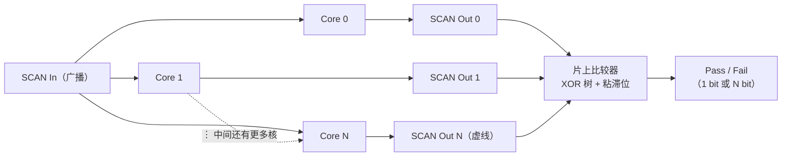
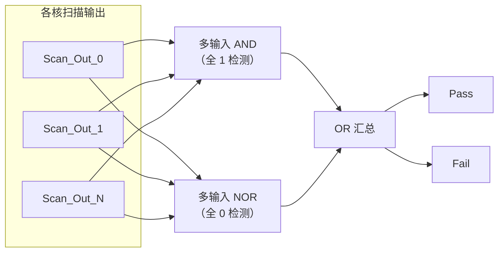
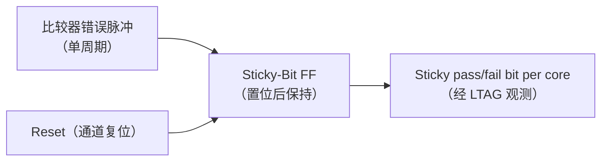
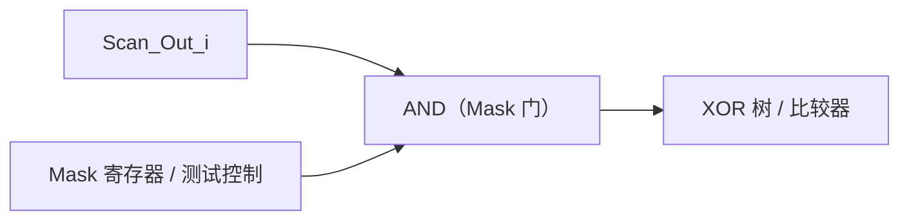
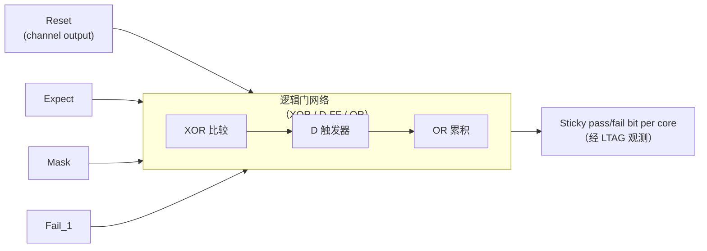
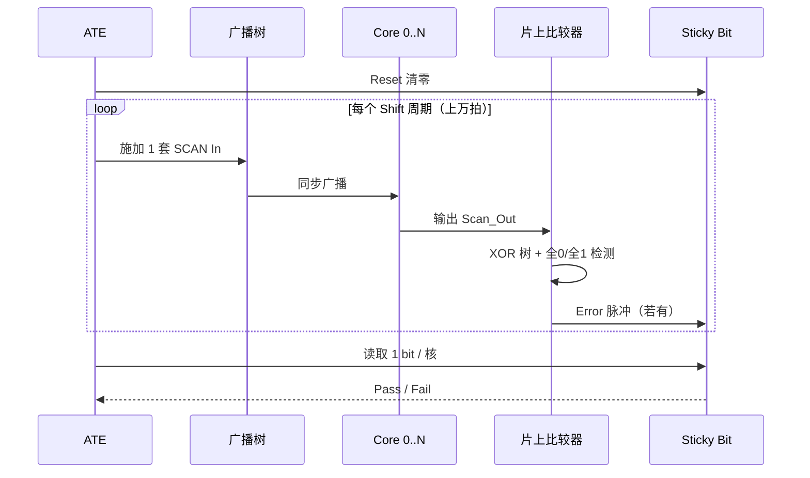

# SCAN 片上比较（On-Chip Compare）技术教材

> **适用对象**：数字 IC 设计、DFT（Design for Testability）工程师、SoC 验证与测试工程人员
> **前置知识**：扫描链（Scan Chain）基本原理、D 触发器、组合逻辑故障模型、ATE 测试流程
> **关键词**：Identical Cores、Broadcast Scan-In、XOR Tree、Sticky Bit、X-Masking、LTAG

---

## 目录

1. [背景：多核时代的测试困境](#1-背景多核时代的测试困境)
2. [整体架构：广播 + 片上比较](#2-整体架构广播--片上比较)
3. [片上比较器结构](#3-片上比较器结构)
4. [粘滞位捕获器](#4-粘滞位捕获器sticky-bit--error-latch)
5. [屏蔽逻辑与 X 态处理](#5-屏蔽逻辑masking-logic与-x-态处理)
6. [比较器内部电路](#6-比较器内部电路on-chip-compare-circuitry)
7. [完整测试时序](#7-完整测试时序)
8. [设计要点与常见陷阱](#8-设计要点与常见陷阱)
9. [本章小结](#9-本章小结)
10. [思考题](#10-思考题)

---

## 学习目标

读完本章，你应当能够：

1. 解释为什么同构多核 SoC 必须引入片上比较技术；
2. 画出"广播输入 + 片上互比"的整体架构，并说明引脚与测试向量为何不随核数增长；
3. 推导 XOR 树与全 0/全 1 检测器的判定逻辑，写出其真值表；
4. 说明粘滞位（Sticky Bit）触发器存在的必要性及其对测试时间的影响；
5. 解释 X 态为何会导致误报，并描述 X-Masking 电路的接入位置与作用方式。

---

## 1. 背景：多核时代的测试困境

现代大规模多核 SoC 与 AI 芯片（GPU、NPU）中，往往集成数十乃至成百上千个**完全相同的处理单元**（Processing Element / Core）。这类结构被称为 **Identical Cores（同构多核）**。

如果沿用传统的"每个核独立引出 Scan-In / Scan-Out 引脚"的做法，会立刻遇到两个爆炸性问题：

| 问题 | 表现 | 后果 |
| --- | --- | --- |
| **测试引脚爆炸** | 引脚数 ∝ 核数 N | 封装引脚、探针卡、ATE 通道资源无法承受 |
| **测试时间爆炸** | 测试向量数 ∝ 核数 N | 单颗芯片测试成本急剧上升 |

片上比较（On-Chip Compare）正是为解决这两个问题而生的核心技术。

### 1.1 核心思想

> **广播输入（Broadcast Scan-In）+ 片上多核结果互比（On-Chip Compare）**

由于所有 Core 结构完全相同、接收完全一致的测试向量、并在相同节拍下运行，**理论上它们的测试响应必须完全一致**。因此不需要外部 ATE 逐个比对每个核的输出，只需在芯片内部判断"各核是否一致"即可。

---

## 2. 整体架构：广播 + 片上比较

### 2.1 架构图

### 2.2 广播机制

外部 ATE 只需提供**一套** SCAN In 激励数据，通过芯片内部的**扇出树（Fan-out Tree）**或广播总线，同时送达所有同构 Core 的扫描链输入端。

由此得到两个关键结论：

- **Scan-In 引脚数恒定**：无论片内有 4 个核还是 1024 个核，外部只需一组输入；
- **测试向量数恒定**：同一套向量并行施加到所有核，向量总量不随核数增长。

> **设计要点**：广播树需要在时序上保证各核**同一周期收到同一比特**。扇出树的平衡性、时钟偏斜（Skew）会直接影响比较结果的有效性——若某核晚一拍，比较器会把它误判为"不一致"。

---

## 3. 片上比较器结构

### 3.1 为什么不需要"期望值"

传统扫描测试需要 ATE 提供**期望值（Expected Value）**逐位比对。而同构多核架构下，比较器采用 **Core-to-Core Comparison（核间互比）**：

- 不需要外部提供期望值；
- 以"多数一致"作为隐含的正确性基准；
- 大幅减少 ATE 存储与通道需求。

### 3.2 XOR 树（异或树）

将所有同构 Core 对应位置的扫描链输出 `Scan_Out_0, Scan_Out_1, ..., Scan_Out_N` 送入一个多输入异或门树；工程上也常采用**相邻两两异或**的方式（`Core0 ^ Core1`、`Core1 ^ Core2` ……）。

**判定原理**：

- 所有 Core 输出**全为 0** 或**全为 1** → 两两异或结果**全为 0** → 一致（Pass）；
- 某个 Core 因故障输出与其他核不同 → 异或门输出 **1** → 存在差异（Fail）。

### 3.3 全 0 / 全 1 检测器

仅靠异或树还不够：需要同时确认"要么全 1、要么全 0"，而不是"部分 1 部分 0"。

- **多输入与门（AND）**：检测是否**全为 1**；
- **多输入或非门（NOR）**：检测是否**全为 0**；
- 两者结果经**或门（OR）**汇总：任一条件成立即判为 Pass。

### 3.4 判定真值表（以 3 核为例）

| Core0 | Core1 | Core2 | 异或树输出 | AND(全1) | NOR(全0) | 结论 |
| :---: | :---: | :---: | :---: | :---: | :---: | :---: |
| 0 | 0 | 0 | 0 | 0 | 1 | **Pass** |
| 1 | 1 | 1 | 0 | 1 | 0 | **Pass** |
| 0 | 0 | 1 | 1 | 0 | 0 | **Fail** |
| 1 | 0 | 1 | 1 | 0 | 0 | **Fail** |
| 0 | 1 | 1 | 1 | 0 | 0 | **Fail** |

> **注意**：若采用"两两异或"方案，需保证比较对象覆盖所有核（链式两两异或即可传递一致性），否则可能出现"两个核同时反向出错但互相抵消"的漏检风险。

---

## 4. 粘滞位捕获器（Sticky Bit / Error Latch）

### 4.1 问题：错误只是一个脉冲

扫描移位（Shift）过程通常持续**上万个时钟周期**。若某一周期出现不一致，比较器只会产生**一个周期宽度的错误脉冲**。若外部 ATE 不逐周期采样，这个错误就会"溜走"。

### 4.2 解决：锁存并保持

在比较器之后接入一个**粘滞位触发器（Sticky-Bit Flip-Flop）**：

- 一旦检测到 `Error = 1`，立即置位并**保持到测试结束**；
- 后续周期即使恢复正常，也不会清除该标志；
- 外部 ATE **只需在测试结束时读取 1 bit**（或每核 1 bit）即可判断良率。

### 4.3 收益对比

| 方案 | 每周期采集量 | ATE 通道需求 | 测试时间影响 |
| --- | --- | --- | --- |
| 传统逐位比对 | 全部 Scan-Out | 高（∝ 核数） | 需完整采集 |
| 片上比较 + Sticky Bit | 1 bit / 核 | 极低 | 仅末端读取 |

---

## 5. 屏蔽逻辑（Masking Logic）与 X 态处理

### 5.1 X 态的来源

实际电路中，某些扫描链寄存器在 **Capture 阶段**可能捕获到**不确定态（X 态）**，常见来源包括：

- 未初始化的 RAM；
- 模拟模块输出；
- 异步跨时钟域路径。

### 5.2 为什么 X 态会误报

不同 Core 的 X 态在仿真或实际硅片上可能表现出**不同电平**（一个出 0、一个出 1）。这会让片上比较器认为"核间不一致"，从而**误报 Fail**。

### 5.3 解决方法：X-Masking

在信号进入比较器**之前**，必须加入 **X-Masking（X 态屏蔽）电路**：

- 通常由额外的 **Mask 寄存器**或**测试控制信号**驱动与门实现；
- 在出现 X 态的移位周期，强制将对应通道屏蔽为**固定值（如 0）**；
- 被屏蔽的通道**不参与比较**。

> **代价与权衡**：屏蔽会降低该周期的**可观测性**，可能掩盖真实故障。因此 Mask 的粒度（按通道 / 按周期）与覆盖率之间需要仔细权衡，通常结合 ATPG 的 X-masking 策略协同优化。

---

## 6. 比较器内部电路（On-Chip Compare Circuitry）

下图对应典型实现：左侧为输入信号，中间为异或树与粘滞逻辑，右侧为每核的 Pass/Fail 标志。

对应关系说明：

| 信号 | 作用 |
| --- | --- |
| `Reset (channel output)` | 每个测试通道开始前的复位，清除粘滞状态 |
| `Expect` | 期望值输入（互比架构下可来自其他核或参考通道） |
| `Mask` | X 态屏蔽控制 |
| `Fail_1` | 上一级失败标志的级联输入 |
| `Sticky pass/fail bit per core` | 最终输出，经 **LTAG** 链观测读出 |

---

## 7. 完整测试时序

**关键时序约束**：

1. 各核 Scan-Out 必须**同拍对齐**；
2. Sticky Bit 必须在测试开始前可靠复位；
3. Mask 信号需在对应移位周期**提前建立**，避免毛刺；
4. 读取阶段通过 LTAG 串行移出，注意与主扫描链的调度冲突。

---

## 8. 设计要点与常见陷阱

| 类别 | 要点 | 风险 |
| --- | --- | --- |
| 时序 | 广播树平衡、Skew 控制 | 偏斜导致误判 |
| 逻辑 | XOR 树覆盖所有核 | 链式两两异或需保证传递性 |
| 复位 | Sticky Bit 可靠复位 | 残留状态导致假 Fail |
| 屏蔽 | Mask 粒度与覆盖率权衡 | 过度屏蔽掩盖真实缺陷 |
| 观测 | LTAG 读取调度 | 与主链冲突、读取遗漏 |
| 可诊断性 | 输出 1 bit 还是 N bit | 1 bit 只能判 Pass/Fail，无法定位故障核 |

> **延伸思考**：若输出为 **N bit**（每核 1 bit），则可在良率损失时快速定位**哪个核**出错，代价是观测通道增加。实际工程中常在"1 bit 快速筛选"与"N bit 故障定位"之间做分级设计。

---

## 9. 本章小结

1. **问题**：同构多核导致测试引脚与测试时间随核数线性爆炸。
2. **思路**：广播输入 + 片上互比，用"一致性"替代"逐位期望值比对"。
3. **比较**：XOR 树判差异，AND/NOR 判全 1/全 0，OR 汇总输出 Pass/Fail。
4. **保持**：Sticky Bit 将单周期错误脉冲锁存至测试结束，ATE 末端读 1 bit。
5. **防护**：X-Masking 在比较前屏蔽不确定态，避免误报。

---

## 10. 思考题

1. 若 1024 个同构核中只有 1 个核在某一拍出错，XOR 树的输出是什么？Sticky Bit 最终读到什么？
2. 为什么"全 0 或全 1"检测不能只用 XOR 树完成？请构造一个 XOR 树无法区分、但 AND/NOR 可以区分的场景。
3. 若广播树中某一路延迟多一个时钟周期，比较器会表现为什么现象？如何在不改版图的前提下定位该问题？
4. X-Masking 屏蔽某一通道后，该通道上的固定型故障（Stuck-at）是否还能被检测？请说明理由。
5. 在"1 bit 输出"与"N bit 输出"之间，你会如何根据产品定位（成本敏感 / 可维护性优先）做选择？

---

## 附录：术语表

| 缩写 / 术语 | 全称 | 说明 |
| --- | --- | --- |
| DFT | Design for Testability | 可测试性设计 |
| ATE | Automatic Test Equipment | 自动测试设备 |
| Scan Chain | 扫描链 | 将触发器串成移位寄存器的测试结构 |
| Shift | 移位 | 测试向量串行移入 / 响应移出的过程 |
| Capture | 捕获 | 在功能时钟下捕获电路响应 |
| XOR Tree | 异或树 | 多输入异或门构成的比较网络 |
| Sticky Bit | 粘滞位 | 一旦置位便保持的故障标志位 |
| X-Masking | X 态屏蔽 | 将不确定态通道强制为固定值的电路 |
| LTAG | — | 用于观测片上测试标志的串行访问结构 |
| Skew | 时钟偏斜 | 同一时钟到达不同寄存器的时间差 |

---

